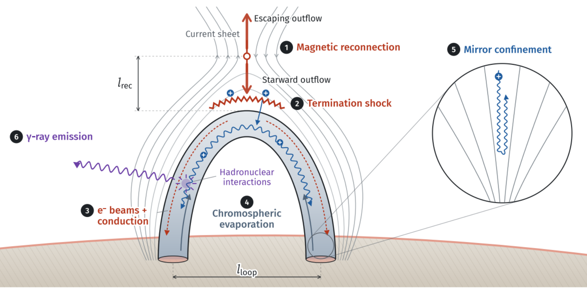

Aplicamos un modelo hadrónico bayesiano a una candidata a megafulguración en rayos $\gamma$ de una estrella joven en NGC 2071, mostrando que reproducir el flujo observado por Fermi requiere ajustar el índice de inyección de protones a partir de las observaciones en lugar del valor teórico estándar.

[Download proceeding here]()

