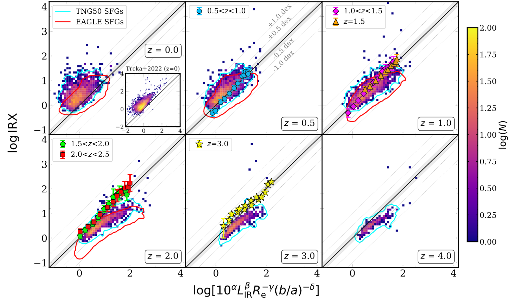

We test whether star-forming galaxies in the TNG50 cosmological simulation reproduce the universal infrared excess (IRX) scaling relation across z = 0 to 4, investigating how dust-to-metal ratios, dust composition, metallicity, and infrared luminosity drive the redshift-dependent offsets from observations.

[Download paper here](https://arxiv.org/abs/2611.32592)

Recommended citation: Cataldi et. al. (2026c)
